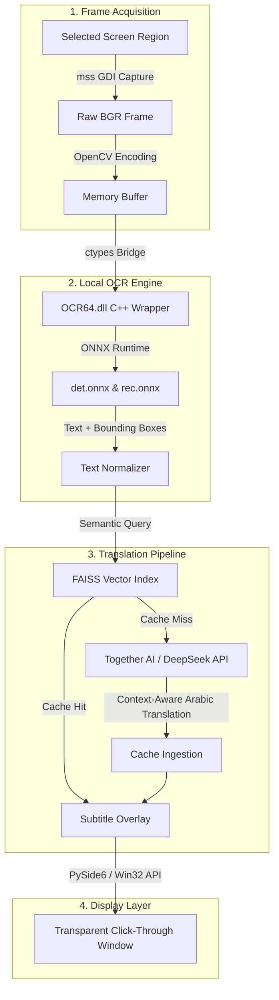

# Instant Game Translator (V2 Prototype)

[](https://github.com/MONaser04/Instant-Game-Translator)
[-blue.svg)](https://github.com/MONaser04/SETJA)
[](https://www.python.org/)
[](https://pypi.org/project/PySide6/)
[](LICENSE)

> [!WARNING]
> **ARCHIVAL NOTICE**: This repository represents the **V2 Python prototype** developed in February 2025. It is now archived and no longer actively maintained. For the production-grade, low-latency, native C++ DirectX engine that succeeded this project, see **[SETJA](https://github.com/MONaser04/SETJA)**.

---

## 📖 Historical Evolution

| Version | Period | Architecture & Tech Stack | Performance / Resource Profile | Status |
| :--- | :--- | :--- | :--- | :--- |
| **V1** | Sep 2024 | Monolithic Python script (~1,500 LOC), Tesseract OCR, Google Translate API | ~2,500ms latency, high CPU spikes, brittle screen capture | Retired |
| **V2 (This Repo)** | Feb 2025 | Modular Python (`PySide6`), `mss` capture, PaddleOCR ONNX/C++ DLL, Together AI (DeepSeek-V3), FAISS Semantic Cache | ~600-800ms latency, ~85% CPU load (Python GIL & IPC bottlenecks) | **Archived Prototype** |
| **V3 ([SETJA](https://github.com/MONaser04/SETJA))** | Jun 2026 | Pure C++20, DirectX Desktop Duplication (DXGI), Shared Memory IPC, SIMD | **<100ms latency, <5% CPU utilization** | **Active Production** |

---

## 🔍 Overview & System Architecture

Instant Game Translator V2 was developed as a modular desktop application designed to capture real-time gaming subtitles, extract text using an embedded local OCR pipeline, translate dialogue using modern Large Language Models (LLMs), and project translations back over the game using a hardware-accelerated click-through transparent overlay.



---

## 🛠️ Key Components & Implementation Details

1. **Screen Capture Engine (`core/capture/`)**
   - High-rate region-specific screen grabbing using `mss`.
   - Dynamic region selector widget with hotkey activation (`core/ui/region_selector.py`).

2. **Embedded PaddleOCR Pipeline (`core/ocr/`)**
   - Direct C-types FFI bridge to `OCR64.dll`.
   - Local inference without external heavy Python PaddlePaddle dependencies, loading `det.onnx`, `rec.onnx`, and dictionary files locally.
   - Text clustering and Y-coordinate sorting for multi-line subtitle reconstruction.

3. **Context-Aware Translation (`core/translator/`)**
   - Integration with Together AI / OpenRouter (DeepSeek chat models).
   - Specialized system prompt engineered for video game dialogue (handles fantasy naming conventions, line breaks, informal/formal tones, and context continuity).

4. **Semantic Embedding Cache (`text/translation_cache.py`)**
   - Sentence embeddings via `SentenceTransformer` (`all-MiniLM-L6-v2`).
   - L2 distance indexing via `faiss.IndexFlatL2` to recognize recurring game dialogue instantly without making external API calls.

5. **Transparent Subtitle Overlay (`core/ui/overlay_window.py`)**
   - Frameless, translucent PySide6 window.
   - Win32 API interop (`WS_EX_TRANSPARENT | WS_EX_LAYERED`) enabling full mouse and keyboard input pass-through directly to games.

---

## 📂 Repository Structure

```
Instant-Game-Translator/
├── config/
│   ├── constants.py           # System-wide constants & defaults
│   └── settings.py            # Runtime configuration manager
├── core/
│   ├── app_utils/             # Text cleaning & string manipulation
│   ├── capture/               # mss-based frame acquisition & preprocessing
│   ├── ocr/                   # C++ DLL wrapper & local ONNX model files
│   │   └── files/             # OCR64.dll, det.onnx, rec.onnx, dict.txt
│   ├── translator/            # LLM API client & prompt configuration
│   ├── ui/                    # PySide6 transparent overlay & region selector
│   └── test.py                # CPU% and RSS memory benchmarking harness
├── text/
│   └── translation_cache.py   # FAISS vector semantic similarity caching
├── main.py                    # Application bootstrap & event orchestration
├── requirements.txt           # Python package requirements
├── settings.json              # Saved application preferences
└── README.md                  # Project documentation
```

---

## 🚀 Setup & Execution (Legacy Reference)

```bash
# 1. Clone repository
git clone https://github.com/MONaser04/Instant-Game-Translator.git
cd Instant-Game-Translator

# 2. Create virtual environment
python -m venv .venv
source .venv/Scripts/activate  # On Windows: .venv\Scripts\activate

# 3. Install dependencies
pip install -r requirements.txt

# 4. Set API Key
set TOGETHER_API_KEY=your_api_key_here

# 5. Launch application
python main.py
```

---

## 💡 Lessons Learned & Successor

While V2 demonstrated that LLM-driven game translation with local OCR was functionally viable and accurate, profiling via `core/test.py` exposed fundamental limits of a pure Python desktop architecture for real-time applications:
- **CPU Overhead**: Polling loops and image marshalings across Python/C boundaries consumed significant CPU cycles (~80-85%).
- **Frame Latency**: Traditional GDI/desktop capture lacked hardware synchronization.

These lessons formed the engineering blueprint for **[SETJA](https://github.com/MONaser04/SETJA)**, which replaced the Python runtime entirely with modern C++20 and DirectX Desktop Duplication (DXGI), achieving an order-of-magnitude reduction in latency and resource consumption.

---

## 📄 License

This repository is distributed under the MIT License. See [LICENSE](LICENSE) for details.
